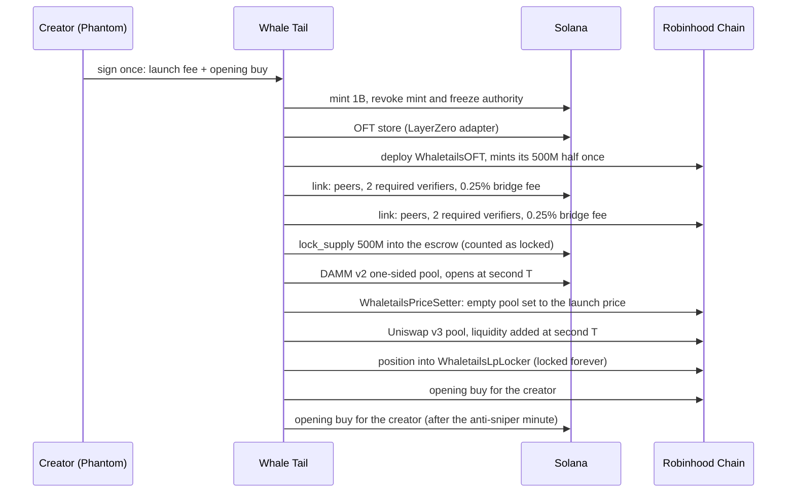

# Whale Tail

**Meteora-native trading: copy the best LPs, and launch coins on Solana, BNB Chain and Robinhood Chain, or one coin on Solana and Robinhood at the same second.**

[whaletails.fun](https://whaletails.fun) · [Launchpad](https://whaletails.fun/launch) · [X](https://x.com/CryptoSenius)

Whale Tail has two products, both built on Meteora and live on mainnet.

| | What it does | Meteora pieces |
|---|---|---|
| **Copy LPs** | Finds the best liquidity providers on Meteora from on-chain data, ranks them by real returns, and mirrors their positions for members automatically: opens, closes, partial exits, top-ups, rebalances and fee claims. **34,000+ live copy trades mirrored so far**, with stop losses checked every 30 seconds. Now also on Robinhood Chain. | DLMM |
| **Launchpad** | Launch a coin on **Solana**, **BNB Chain** or **Robinhood Chain**, or one coin on Solana and Robinhood at the same second with liquidity locked on both chains. Bonding curves graduate into locked pools; on BNB a coin can also open straight into a locked PancakeSwap pool. Open to everyone. | Dynamic Bonding Curve, DAMM v2 |

> **Updated 2026-10-19.** Everything added since the submission is in [What's new](#whats-new-since-the-submission-2026-10-13--10-19) just below.

### What is public and what is private

This repository is a **showcase for review**: architecture, the smart contracts we wrote, and on-chain proof. **Everything else is kept private on purpose**: the server that runs the platform (the copy engine, the position mirror, the AutoRun ranking, the launchpad backend and keepers, the Telegram bot and its wallets), our infrastructure, keys and operations. The contracts here are the ones that hold or move value on chain, so anyone can check them against what is deployed.

---

## What's new since the submission (2026-10-13 → 10-19)

**Built on 2026-10-19: launch from Telegram, from one line or from an X post**

- **A wallet inside Telegram.** Send `/start` to [@WhaleTailBot](https://t.me/WhaleTailBot) and tap *Create my Whale Tail wallet*: a Solana wallet is ready in seconds, no website, no browser wallet, no seed phrase. `/start` then works as a home screen: address, balance and next steps.
  - **Locked down by design:** the bot never shows a private key and has no way to send funds out. `/protect` adds an email and password through a one-time, 15-minute link, after which every sign-in from a new device needs a code from the bot (2FA). Showing a key stays on the website: password, a Telegram code, a 24-hour wait, then password and code again, and the bot now tells the member the moment the wait is over.
  - One account per Telegram user, private chats only, and the same site-wide sign-up limit as every other way in.
- **`/launch <idea>`: a coin from one line.** `/launch a cat with fire in the hair` reads the words (16 animals, about 90 trait words such as fire, lasers, crowns, shades or country flags), draws a matching mascot logo from parts (no AI image service, no cost), names the coin and picks a ticker. The user sees a preview with *Launch*, *New look*, *Change name*, *Opening buy* and *Cancel*; when the idea is something the mascot cannot draw, the bot asks for a picture instead.
- **`/launch <X link>`: a coin from any X post,** in the bot and on the website (*Launch from an X post* fills the whole create form). The post is read without logging in to X: its picture becomes the logo (cropped square), its `$cashtag` the ticker, the post is quoted in the description and linked as the coin's X page. Prices such as `$146.03` are never taken for a ticker.
- **Paid by the creator, nothing else.** A Telegram launch is created from the member's own Whale Tail wallet, which pays the transaction: about **0.021 SOL** of Solana network costs, no launch fee. The balance is checked first, with a deposit prompt when it is short.
- **The 10 SOL bonding bounty, visible everywhere.** Bond a coin on a regular 85 SOL Meteora curve and win 10 SOL: a banner and a live *Closest to bonding* race on the launchpad, and `/bounty` in the bot.

Example, launched end to end from a wallet made in Telegram, from an X post: [`DEutELZp…oWTL`](https://solscan.io/token/DEutELZpyFYaQkGYdEK4QDgYEtdVPa4BL494w5N8oWTL) on the 85 SOL Meteora DBC curve.

**Launchpad: three chains**

- **BNB Chain is live.** Two ways to launch, from MetaMask, Rabby or any EVM wallet, paid in BNB:
  - **Bonding curve** (`WTCurve`): a fair curve that graduates into a locked **PancakeSwap v3** pool, at exactly the curve's final price.
  - **Instant PancakeSwap** (`WTInstant`): the coin opens **straight into a locked PancakeSwap v3 pool** holding the whole supply, one-sided, in the same transaction that creates it, so nobody can create the pool first at another price. The creator's opening buy is the pool's first trade, so the coin **shows on DexScreener and trading terminals from its first trade**. Pool fees split 50/50 creator and platform through the locker.
- **Robinhood Chain bonding curve** (`WTCurve`) is live alongside the instant Uniswap launch: buyers trade on the curve until it fills, then it graduates into a locked **Uniswap v3** pool.
- **Creators choose the graduation target** on Solana: **30, 50 or 85 SOL**. Lower graduates sooner; higher gives a deeper pool. Each target is its own Meteora DBC config.
- **One engine for every EVM chain.** The same contracts and server are built and tested end to end on **39 EVM chains** (local devnets of each chain: Uniswap v3, PancakeSwap v3 and Uniswap v2-style DEXes). Mainnet chains are opened one at a time after a real mainnet test; BNB Chain was the first.

**Copy LPs**

- **AutoRun learns from every copy.** Members on Auto get a weekly whale rotation ranked by **what each whale actually returned to everyone copying it**. A whale that is losing across all copies (40+ closed positions) is now dropped automatically, even before it has cost that member anything.
- **Exactly one copy per whale position.** A guard makes a second open of the same whale position impossible, whichever path (transaction feed or position watcher) sees it first.
- **Robinhood Chain copy trading** is open to everyone: a meme-only board of the top Robinhood LPs, each member's own Robinhood wallet, and a 5% performance fee charged only on profitable closes, never on a loss.

**Security**

- **Showing a private key** takes the account's password, a code from the Whale Tail bot on Telegram, and a 24-hour wait. Accounts that sign in with a wallet add a password with a fresh signature from that wallet plus a Telegram code, so a stolen session alone can never set one.

**Live contracts added**

| | Address |
|---|---|
| BNB Chain curve factory (`WTCurve`) | [`0x5D57056688e712c8d9902ca5B4d07166a82F8388`](https://bscscan.com/address/0x5D57056688e712c8d9902ca5B4d07166a82F8388) |
| BNB Chain instant factory (`WTInstant`) | [`0xFf94dcd4c38d9B1783b561029396446380390Ed9`](https://bscscan.com/address/0xFf94dcd4c38d9B1783b561029396446380390Ed9) |
| BNB Chain LP locker | [`0x128B13BC617D724ef03322BE7dDF30D6849E32E1`](https://bscscan.com/address/0x128B13BC617D724ef03322BE7dDF30D6849E32E1) |
| Robinhood Chain curve factory (`WTCurve`) | [`0x08492fF20800C6f100068e5754Ff39ee76EF797f`](https://explorer.chain.robinhood.com/address/0x08492fF20800C6f100068e5754Ff39ee76EF797f) |

Example instant launch on BNB Chain: coin [`0x0a2734E7…9776`](https://bscscan.com/token/0x0a2734E7d116a4f358aD380e6340402ea4F79776), PancakeSwap v3 pool [`0x92C62fF7…8448`](https://dexscreener.com/bsc/0x92c62ff7e231cf00b1de73ccaf664e5dfa998448), listed on DexScreener right after its first trade.

**In numbers (2026-10-19, evening):** 34,000+ copy trades mirrored · 118 members · 109 coins launched (101 Solana, 5 Solana + Robinhood, 2 Robinhood, 1 BNB), 20 of them from Telegram on the first day, 9 of those from X posts.

---

## The launchpad

### Two ways to launch

**Solana.** A coin starts on a Meteora **Dynamic Bonding Curve** and graduates into a locked **DAMM v2** pool when the curve fills (85 SOL). The creator picks one of four curve styles:

| Style | Price from first buy to graduation |
|---|---|
| Classic | about 16x, one smooth curve |
| Long runway | about 5x: late buyers pay close to what early buyers paid |
| Steep | about 80x: rewards early conviction |
| Compounding pool | classic curve; after graduation half the pool fees are reinvested, so liquidity keeps growing |

Team launches split creator fees across members through a per-coin vault, and supporters can pledge liquidity that goes into the graduated pool, locked.

**Creator fees are claimed, not airdropped.** Like pump.fun, each team member claims their own share from the coin page, signing with their own wallet. Nothing is sent to anyone who does not ask, so no transaction fees are spent on payouts nobody needed yet. The claim pulls the fees that accrued into the coin's vault and pays the claimant in the same transaction; every other member's share is set aside for them until they claim.

**Solana + Robinhood Chain.** One coin, 1,000,000,000 supply, half on each chain:

- a one-sided **Meteora DAMM v2** pool on Solana with an anti-sniper fee (50% falling to 1% over the first minute),
- a one-sided **Uniswap v3** pool on Robinhood Chain,
- both open **at the same second, at the same USD price**,
- liquidity **locked forever** on both chains,
- the two halves linked by a **LayerZero OFT** bridge, so holders move coins between chains in about a minute.

The creator puts in no SOL or ETH liquidity. One signature pays the launch fee plus an opening buy, which is bought for the creator on both chains right after opening, so every coin trades and is listed on DEX screeners on both chains within a minute.

### Launch from anywhere

- **Web:** Phantom, Solflare or Backpack; MetaMask or Rabby for Robinhood trades. The wallet always signs **first** and our keys (the new mint, the coin's vault) sign after, so wallets can simulate every transaction and never show a "malicious dApp" warning.
- **Telegram mini app:** launch and trade with a custodial Whale Tail wallet, no browser wallet needed.
- **Every coin page** shows what its creator has earned from trading fees on both chains, and every coin link previews as its own share card (logo, chains, market cap) when posted on X or Telegram.

### How a 2-chain launch works

### Why no bridge at launch

The obvious design bridges half the supply across at launch. On mainnet that made a launch wait on a cross-chain verifier, once for more than 45 minutes. So the bridge is not used at launch at all:

- the Robinhood contract **mints its half once, in its constructor**;
- on Solana, the matching half is locked with **`lock_supply`**, an instruction we added to LayerZero's Solana OFT program. It moves the coins into the escrow **and** counts them as locked (`tvl_ld`), exactly as a bridge send would, without a message.

The result is the same state as a completed bridge, reached in seconds: every coin on Robinhood is backed 1:1 by a coin locked on Solana. We checked that the locked amount equals the Robinhood supply after launch and after every transfer in both directions.

Without counting the lock, the first transfer back to Solana would underflow `tvl_ld` and fail, which is why a plain token transfer into the escrow is not enough.

### Fees

| Fee | Where it goes |
|---|---|
| Launch fee (2-chain) | platform treasury |
| Trading fees, Solana pool | 50% creator team, 50% platform |
| Trading fees, Robinhood pool | 50% creator, 50% platform (split by `WhaletailsLpLocker`) |
| Bridge fee, 0.25% each way | platform, paid in the coin |
| Solana curve fees (DBC) | creator team and platform |

Creator payouts are automatic. Each coin's vault always keeps Solana's rent-exempt minimum and pays out everything above it.

### Security choices

- **Fixed supply:** mint and freeze authority revoked at launch.
- **Locked liquidity:** DAMM v2 positions permanently locked; Uniswap positions held by `WhaletailsLpLocker`, which has no function to remove liquidity.
- **No pre-created pools at a fake price:** a coin's address is public before its pools exist. On Solana, a pool is only used if its creator is the coin's own vault. On Robinhood, `WhaletailsPriceSetter` moves an empty Uniswap pool to the launch price before liquidity goes in, and refuses if someone else's liquidity is already there.
- **Opening buys cannot be sandwiched:** every opening buy has a quoted minimum out on both chains.
- **Verifiers:** each coin requires **two** independent LayerZero verifiers, LayerZero Labs and Nethermind, set explicitly on both chains. The default verifier for this route on Robinhood mainnet was a deprecated "dead" verifier, and LayerZero Labs does not sign for 1-of-1 setups, so neither the default nor a single verifier would deliver.
- **Crash-safe launches:** every paid step records what it is about to create before sending, and checks the chain on a rerun, so a restart never pays for a step twice.
- **Signed transactions:** wallets may add a priority fee and Phantom's Lighthouse guards; anything else is refused.
- **Clear errors before signing:** a launch checks the wallet's SOL first, instead of failing on chain.

---

## Pair a coin with USDC, tokenized stocks or Sunrise assets

Live on mainnet since 2026-10-13. A Solana curve coin can trade against something other than SOL:

- **Popular:** SOL, USDC, and the xStocks TSLAx, NVDAx, SPYx and AAPLx.
- **Sunrise:** 113 assets listed on Solana through [Sunrise](https://sunrise.xyz) (Wormhole Labs): tokenized stocks issued by Backpack Securities (MU, AMD, NFLX, HOOD, IONQ and more) and crypto assets (TAO, DOGE, LINK, AVAX, HYPE and more).

**Everyone still pays and gets paid in SOL.** A buy swaps SOL into the pairing through Jupiter and buys the coin in the **same transaction**; a sell does the reverse. Nobody needs to hold USDC or a stock token. Fees stay in the token they arrive in.

How it was checked:

- Pairing mints are fixed in code from the issuers' own lists (Jupiter lists lookalike tokens with the same tickers).
- Every Sunrise asset was checked on mainnet for a Jupiter SOL route and, for Token-2022 mints, a Meteora DBC token badge. Five assets were left out because Meteora cannot use them as a curve's pairing.
- On devnet, wallets holding only SOL launched, bought, sold, graduated and traded on the pool for USDC, xStocks, a Backpack stock and a crypto asset.
- On mainnet, a SOL-paid buy and a SOL-returning sell on a real USDC DAMM v2 pool, and SOL to each xStock, were **simulated** (nothing sent): all pass, at 690 to 900 bytes.
- Then with real funds on mainnet, before opening to everyone: a SOL coin, a TSLAx coin and a Sunrise RIOT coin were each launched, bought, sold and their creator fees claimed, and the platform's half collected, in each coin's own pairing.
- The automatic SOL to pairing swap allows 2% price movement, so thin markets do not fail a launch while the wallet is signing.

---

## Contracts in this repository

| File | Chain | What it is |
|---|---|---|
| [`contracts/WhaletailsOFT.sol`](contracts/WhaletailsOFT.sol) | Robinhood Chain | The coin on Robinhood: LayerZero OFT that mints its half once at deployment and charges the bridge fee. |
| [`contracts/WhaletailsLpLocker.sol`](contracts/WhaletailsLpLocker.sol) | Robinhood Chain | Holds Uniswap v3 launch positions forever; anyone can trigger the 50/50 fee split. |
| [`contracts/WhaletailsPriceSetter.sol`](contracts/WhaletailsPriceSetter.sol) | Robinhood Chain | Moves an empty Uniswap v3 pool to the launch price before liquidity goes in; reverts if the pool holds liquidity. |
| [`solana-oft/lock_supply.rs`](solana-oft/lock_supply.rs) | Solana | The instruction we added to LayerZero's OFT program. |
| [`contracts/WTCurve.sol`](contracts/WTCurve.sol) | BNB Chain, Robinhood Chain (any EVM chain) | The bonding curve and its factory: constant product with a phantom reserve, snipe tax, graduation into a locked Uniswap v3 or PancakeSwap v3 position at the curve's final price. No owner, no withdrawal of curve funds. |
| [`contracts/WTInstant.sol`](contracts/WTInstant.sol) | BNB Chain (any EVM chain) | Instant launch: fixed 1B supply, pool created and initialised in the same transaction, the whole supply one-sided and locked, the creator's opening buy as the first trade. |

---

## Live on mainnet

**Platform**

| | Address |
|---|---|
| Solana OFT program (with `lock_supply`) | [`2zotveKhAqrUqaqAhXam2qxPEkSSKWXDEA9JAav2gwoH`](https://solscan.io/account/2zotveKhAqrUqaqAhXam2qxPEkSSKWXDEA9JAav2gwoH) |
| Robinhood LP locker | [`0x128B13BC617D724ef03322BE7dDF30D6849E32E1`](https://explorer.chain.robinhood.com/address/0x128B13BC617D724ef03322BE7dDF30D6849E32E1) |

The Solana program is a verifiable build (sha256 `7d5f9f26e721dfd9bc069e86ca68d3b73cf867831feb9eec6c0c8a0a1a3c8534`); the bytes on chain match it.

**Example: a 2-chain coin, opened at the same second on both chains**

| | |
|---|---|
| Solana coin | [`Bok4CcPgN6AswsHWv9TPUYuWWJupLPrj4mAcDo6htWLQ`](https://solscan.io/token/Bok4CcPgN6AswsHWv9TPUYuWWJupLPrj4mAcDo6htWLQ) |
| Meteora DAMM v2 pool | [`GkDD19BLuREpbcsKDfG7ygFg8bXoEbY6X7Y3k6MvhLm2`](https://dexscreener.com/solana/gkdd19blurepbcskdfg7ygfg8bxoeby6x7y3k6mvhlm2) |
| Robinhood coin | [`0xBD28399037d69AA08b5E3BB3e11b87fa515b6316`](https://explorer.chain.robinhood.com/address/0xBD28399037d69AA08b5E3BB3e11b87fa515b6316) |
| Uniswap v3 pool | [`0x9270E95935446535C577eD8070E08C74F56eacF1`](https://dexscreener.com/robinhood/0x9270e95935446535c577ed8070e08c74f56eacf1) |
| Supply lock on Solana | [`2Br4YoCK…`](https://solscan.io/tx/2Br4YoCKmvyMG1oGzT6mY92Z5dXQsRSUdQyJS5SEkqGLxJjMrRbLN4g6gpxAcd1RdTprqck3ouKopJb4PtfwRy3E) |

Uniswap liquidity went in at 10:51:48 UTC and the Meteora pool opened at 10:51:49 UTC. 500,000,000 coins locked on Solana, 500,000,000 on Robinhood.

**Example: a Solana coin on Meteora's Dynamic Bonding Curve**

| | |
|---|---|
| Coin | [`9mamH6tbQJShrpULMf4rN5uHqA9bxhw9C688EFYhCXNL`](https://solscan.io/token/9mamH6tbQJShrpULMf4rN5uHqA9bxhw9C688EFYhCXNL) |
| DBC pool | [`5KjG2iyjzNKPUunwQQKS27GwaLq8LBtm8PNcmk5FD2Eh`](https://dexscreener.com/solana/5kjg2iyjznkpuunwqqks27gwalq8lbtm8pncmk5fd2eh) |

---

## Stack

Node.js server (Express, SQLite) · Meteora DLMM, DBC and DAMM v2 SDKs · LayerZero OFT (Solana program + EVM) · Uniswap v3 on Robinhood Chain · PancakeSwap v3 on BNB Chain · Jupiter (SOL routing for paired coins) · Solidity 0.8.22 / 0.8.26 · Anchor · plain-JS front end under a strict same-origin CSP (Phantom, Solflare, Backpack; MetaMask or Rabby for Robinhood).

## License

Source shown for review. All rights reserved, see [LICENSE](LICENSE). Everything not in this repository (the platform's server, engine, infrastructure and keys) is private.
