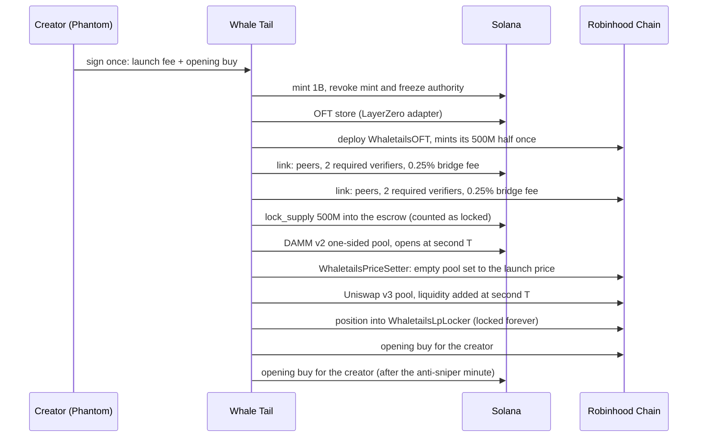

# Whale Tail

**Meteora-native trading: copy the best LPs, and launch one coin on Solana and Robinhood Chain at the same second.**

[whaletails.fun](https://whaletails.fun) · [Launchpad](https://whaletails.fun/launch) · [X](https://x.com/CryptoSenius)

Whale Tail has two products, both built on Meteora and live on mainnet.

| | What it does | Meteora pieces |
|---|---|---|
| **Copy LPs** | Finds the best liquidity providers on Meteora from on-chain data, ranks them by real returns, and mirrors their positions for members automatically. 27,000+ live copy trades mirrored so far, with stop losses checked every 30 seconds. | DLMM |
| **Launchpad** | Launch a coin on a Solana bonding curve, or on Solana and Robinhood Chain at the same second, at the same price, with liquidity locked on both chains. Open to everyone. | Dynamic Bonding Curve, DAMM v2 |

This repository is a showcase for review: architecture, the contracts we wrote, and on-chain proof. The server that runs the platform is not published.

---

## The launchpad

### Two ways to launch

**Solana.** A coin starts on a Meteora **Dynamic Bonding Curve** and graduates into a locked **DAMM v2** pool when the curve fills (85 SOL). The creator picks one of four curve styles:

| Style | Price from first buy to graduation |
|---|---|
| Classic | about 16x, one smooth curve |
| Long runway | about 5x: late buyers pay close to what early buyers paid |
| Steep | about 80x: rewards early conviction |
| Compounding pool | classic curve; after graduation half the pool fees are reinvested, so liquidity keeps growing |

Team launches split creator fees across members through a per-coin vault, and supporters can pledge liquidity that goes into the graduated pool, locked.

**Solana + Robinhood Chain.** One coin, 1,000,000,000 supply, half on each chain:

- a one-sided **Meteora DAMM v2** pool on Solana with an anti-sniper fee (50% falling to 1% over the first minute),
- a one-sided **Uniswap v3** pool on Robinhood Chain,
- both open **at the same second, at the same USD price**,
- liquidity **locked forever** on both chains,
- the two halves linked by a **LayerZero OFT** bridge, so holders move coins between chains in about a minute.

The creator puts in no SOL or ETH liquidity. One signature pays the launch fee plus an opening buy, which is bought for the creator on both chains right after opening, so every coin trades and is listed on DEX screeners on both chains within a minute.

### Launch from anywhere

- **Web:** Phantom, Solflare or Backpack; MetaMask or Rabby for Robinhood trades. The wallet always signs **first** and our keys (the new mint, the coin's vault) sign after, so wallets can simulate every transaction and never show a "malicious dApp" warning.
- **Telegram mini app:** launch and trade with a custodial Whale Tail wallet, no browser wallet needed.
- **Every coin page** shows what its creator has earned from trading fees on both chains, and every coin link previews as its own share card (logo, chains, market cap) when posted on X or Telegram.

### How a 2-chain launch works

### Why no bridge at launch

The obvious design bridges half the supply across at launch. On mainnet that made a launch wait on a cross-chain verifier, once for more than 45 minutes. So the bridge is not used at launch at all:

- the Robinhood contract **mints its half once, in its constructor**;
- on Solana, the matching half is locked with **`lock_supply`**, an instruction we added to LayerZero's Solana OFT program. It moves the coins into the escrow **and** counts them as locked (`tvl_ld`), exactly as a bridge send would, without a message.

The result is the same state as a completed bridge, reached in seconds: every coin on Robinhood is backed 1:1 by a coin locked on Solana. We checked that the locked amount equals the Robinhood supply after launch and after every transfer in both directions.

Without counting the lock, the first transfer back to Solana would underflow `tvl_ld` and fail, which is why a plain token transfer into the escrow is not enough.

### Fees

| Fee | Where it goes |
|---|---|
| Launch fee (2-chain) | platform treasury |
| Trading fees, Solana pool | 50% creator team, 50% platform |
| Trading fees, Robinhood pool | 50% creator, 50% platform (split by `WhaletailsLpLocker`) |
| Bridge fee, 0.25% each way | platform, paid in the coin |
| Solana curve fees (DBC) | creator team and platform |

Creator payouts are automatic. Each coin's vault always keeps Solana's rent-exempt minimum and pays out everything above it.

### Security choices

- **Fixed supply:** mint and freeze authority revoked at launch.
- **Locked liquidity:** DAMM v2 positions permanently locked; Uniswap positions held by `WhaletailsLpLocker`, which has no function to remove liquidity.
- **No pre-created pools at a fake price:** a coin's address is public before its pools exist. On Solana, a pool is only used if its creator is the coin's own vault. On Robinhood, `WhaletailsPriceSetter` moves an empty Uniswap pool to the launch price before liquidity goes in, and refuses if someone else's liquidity is already there.
- **Opening buys cannot be sandwiched:** every opening buy has a quoted minimum out on both chains.
- **Verifiers:** each coin requires **two** independent LayerZero verifiers, LayerZero Labs and Nethermind, set explicitly on both chains. The default verifier for this route on Robinhood mainnet was a deprecated "dead" verifier, and LayerZero Labs does not sign for 1-of-1 setups, so neither the default nor a single verifier would deliver.
- **Crash-safe launches:** every paid step records what it is about to create before sending, and checks the chain on a rerun, so a restart never pays for a step twice.
- **Signed transactions:** wallets may add a priority fee and Phantom's Lighthouse guards; anything else is refused.
- **Clear errors before signing:** a launch checks the wallet's SOL first, instead of failing on chain.

---

## In testing: pair a coin with USDC, tokenized stocks or Sunrise assets

Built and running on our devnet test environment, not yet live on mainnet.

A Solana curve coin will be able to trade against something other than SOL:

- **Popular:** SOL, USDC, and the xStocks TSLAx, NVDAx, SPYx and AAPLx.
- **Sunrise:** 113 assets listed on Solana through [Sunrise](https://sunrise.xyz) (Wormhole Labs): tokenized stocks issued by Backpack Securities (MU, AMD, NFLX, HOOD, IONQ and more) and crypto assets (TAO, DOGE, LINK, AVAX, HYPE and more).

**Everyone still pays and gets paid in SOL.** A buy swaps SOL into the pairing through Jupiter and buys the coin in the **same transaction**; a sell does the reverse. Nobody needs to hold USDC or a stock token. Fees stay in the token they arrive in.

How it was checked:

- Pairing mints are fixed in code from the issuers' own lists (Jupiter lists lookalike tokens with the same tickers).
- Every Sunrise asset was checked on mainnet for a Jupiter SOL route and, for Token-2022 mints, a Meteora DBC token badge. Five assets were left out because Meteora cannot use them as a curve's pairing.
- On devnet, wallets holding only SOL launched, bought, sold, graduated and traded on the pool for USDC, xStocks, a Backpack stock and a crypto asset.
- On mainnet, a SOL-paid buy and a SOL-returning sell on a real USDC DAMM v2 pool, and SOL to each xStock, were **simulated** (nothing sent): all pass, at 690 to 900 bytes.

---

## Contracts in this repository

| File | Chain | What it is |
|---|---|---|
| [`contracts/WhaletailsOFT.sol`](contracts/WhaletailsOFT.sol) | Robinhood Chain | The coin on Robinhood: LayerZero OFT that mints its half once at deployment and charges the bridge fee. |
| [`contracts/WhaletailsLpLocker.sol`](contracts/WhaletailsLpLocker.sol) | Robinhood Chain | Holds Uniswap v3 launch positions forever; anyone can trigger the 50/50 fee split. |
| [`contracts/WhaletailsPriceSetter.sol`](contracts/WhaletailsPriceSetter.sol) | Robinhood Chain | Moves an empty Uniswap v3 pool to the launch price before liquidity goes in; reverts if the pool holds liquidity. |
| [`solana-oft/lock_supply.rs`](solana-oft/lock_supply.rs) | Solana | The instruction we added to LayerZero's OFT program. |

---

## Live on mainnet

**Platform**

| | Address |
|---|---|
| Solana OFT program (with `lock_supply`) | [`2zotveKhAqrUqaqAhXam2qxPEkSSKWXDEA9JAav2gwoH`](https://solscan.io/account/2zotveKhAqrUqaqAhXam2qxPEkSSKWXDEA9JAav2gwoH) |
| Robinhood LP locker | [`0x128B13BC617D724ef03322BE7dDF30D6849E32E1`](https://explorer.chain.robinhood.com/address/0x128B13BC617D724ef03322BE7dDF30D6849E32E1) |

The Solana program is a verifiable build (sha256 `7d5f9f26e721dfd9bc069e86ca68d3b73cf867831feb9eec6c0c8a0a1a3c8534`); the bytes on chain match it.

**Example: a 2-chain coin, opened at the same second on both chains**

| | |
|---|---|
| Solana coin | [`Bok4CcPgN6AswsHWv9TPUYuWWJupLPrj4mAcDo6htWLQ`](https://solscan.io/token/Bok4CcPgN6AswsHWv9TPUYuWWJupLPrj4mAcDo6htWLQ) |
| Meteora DAMM v2 pool | [`GkDD19BLuREpbcsKDfG7ygFg8bXoEbY6X7Y3k6MvhLm2`](https://dexscreener.com/solana/gkdd19blurepbcskdfg7ygfg8bxoeby6x7y3k6mvhlm2) |
| Robinhood coin | [`0xBD28399037d69AA08b5E3BB3e11b87fa515b6316`](https://explorer.chain.robinhood.com/address/0xBD28399037d69AA08b5E3BB3e11b87fa515b6316) |
| Uniswap v3 pool | [`0x9270E95935446535C577eD8070E08C74F56eacF1`](https://dexscreener.com/robinhood/0x9270e95935446535c577ed8070e08c74f56eacf1) |
| Supply lock on Solana | [`2Br4YoCK…`](https://solscan.io/tx/2Br4YoCKmvyMG1oGzT6mY92Z5dXQsRSUdQyJS5SEkqGLxJjMrRbLN4g6gpxAcd1RdTprqck3ouKopJb4PtfwRy3E) |

Uniswap liquidity went in at 10:51:48 UTC and the Meteora pool opened at 10:51:49 UTC. 500,000,000 coins locked on Solana, 500,000,000 on Robinhood.

**Example: a Solana coin on Meteora's Dynamic Bonding Curve**

| | |
|---|---|
| Coin | [`9mamH6tbQJShrpULMf4rN5uHqA9bxhw9C688EFYhCXNL`](https://solscan.io/token/9mamH6tbQJShrpULMf4rN5uHqA9bxhw9C688EFYhCXNL) |
| DBC pool | [`5KjG2iyjzNKPUunwQQKS27GwaLq8LBtm8PNcmk5FD2Eh`](https://dexscreener.com/solana/5kjg2iyjznkpuunwqqks27gwalq8lbtm8pncmk5fd2eh) |

---

## Stack

Node.js server (Express, SQLite) · Meteora DLMM, DBC and DAMM v2 SDKs · LayerZero OFT (Solana program + EVM) · Uniswap v3 on Robinhood Chain · Jupiter (SOL routing for paired coins, in testing) · Solidity 0.8.22 · Anchor · plain-JS front end under a strict same-origin CSP (Phantom, Solflare, Backpack; MetaMask or Rabby for Robinhood).

## License

Source shown for review. All rights reserved, see [LICENSE](LICENSE).
